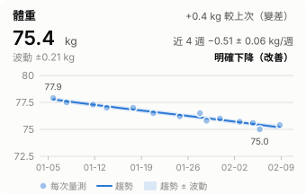
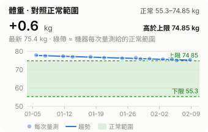

# STARBIA 701 體組成報告

在 STARBIA 701 體組成分析儀量完後，**拍下畫面上的 QR code 傳到這裡**，幾分鐘後就會自動產生：

- **當日報表**：機器報告的完整內容（體重、體脂、肌肉、內臟脂肪、骨密度、各肢段……）＋和上次比較
- **歷史報表**：每個指標的趨勢圖，以及離正常範圍還有多遠

不用裝任何軟體，用瀏覽器或 GitHub App 就能操作，手機也可以。

範例（虛構人物的資料）：[歷史報表](demo/history.md) · [當日報表](demo/reports/2026-02-08_1901.md)

 

> [!IMPORTANT]
> **你的量測資料（姓名、生日、身高、身體數據、照片）會存在你自己的 repo 裡，所以那個 repo 一定要是 Private（私人）。**
> 下面第一次設定的第 1 步會教你怎麼確認。

## 我的最新量測

<!-- latest:start -->
（還沒有量測。先完成下面的「第一次設定」，量完上傳第一張 QR code 後，這裡會自動顯示最新一次的結果與趨勢圖）
<!-- latest:end -->

---

## 第一次設定（只做一次，請用電腦的瀏覽器，約 3 分鐘）

### 1. 建立你自己的 repo，並確認是 Private

- **如果你現在看的是 `jackal998/starbia-bodycomp`（原始範本）**：
  按右上角綠色的 **Use this template** → **Create a new repository** →
  「Repository name」隨便取（例如 `my-bodycomp`）→ 下面選 **Private**（預設是 Public，要改！）→ 按 **Create repository**。
  建好後會跳到你自己的 repo，接著從那裡繼續看這份說明。
- **如果已經在你自己的 repo**：看頁面最上方 repo 名稱旁邊的小標籤，要寫 **Private**。
  如果寫的是 **Public**：點上方的 **Settings** → 拉到最下面紅色的 **Danger Zone** →
  **Change visibility** → **Change to private**，照畫面確認。

> 不要用 **Fork**：fork 出來的 repo 只能是 Public。

### 2. 讓自動處理的機器人可以寫入資料

在你自己的 repo：

1. 點上方分頁最右邊的 **Settings**（齒輪圖示）。
2. 左邊選單點 **Actions** → **General**。
3. 拉到最下面的 **Workflow permissions**，選 **Read and write permissions**，按 **Save**。

設定完成。以後量完照下面做就好。

## 每次量完（手機也可以）

1. **拍照**：在機器上打開「掃描報告結果」，拍下畫面上的 **QR code**（QR 拍大一點、清楚、不要反光）。
   建議量完當下就拍，時間就會自動正確。
2. **上傳**：打開你的 repo → 上方的 **Issues** 分頁 → 綠色 **New issue** → 選 **新增量測** →
   把照片拖進（手機：點一下欄位再選照片）「QR code 照片」欄位 → 按 **Create**（送出）。
   - 「實際量測時間」可以不填：會用照片的拍攝時間（讀不到就用上傳的時間）。不是量完當下拍的，就填實際時間，例如 `2026-01-15 18:30`。
3. **確認**：等 1–2 分鐘（沒出現就重新整理頁面），機器人會留言，列出讀到的體重、體脂率等數值，以及它要用的**量測時間**。
   在頁面最下面的留言框輸入，然後按 **Comment**：
   - 時間正確 → `/confirm`
   - 時間不對 → `/confirm 2026-01-15 18:30`（改成正確的時間，台灣時間）
4. **完成**：再等 1–2 分鐘，issue 會自動關閉，機器人留言裡有報表連結。
   回到 repo 首頁（上方 **Code** 分頁），這份說明最上面的「我的最新量測」也會更新。

一次量測開一個 issue；同一張 QR 重複送不會重複記錄。

## 看報表

- **repo 首頁的「我的最新量測」**：最新一次的數值和 4 張趨勢圖。
- **當日報表**：點首頁上的日期，或機器人留言裡的連結。最後的「可信度說明」講哪些數值是確認過的、哪些是推定。
- **歷史報表**：`body-comp/history.md`。每個指標一張趨勢圖；有正常範圍的指標旁邊多一張「對照正常範圍」的圖。
  - 趨勢圖上的「近 4 週 −0.5 ± 0.1 /週」是最近 4 週平均每週的變化；標「明確下降／上升」才是真的在變，
    「還看不出方向」代表變化還在量測誤差內。
  - 「波動 ±x」：單次量測大概會上下跳這麼多，比它小的變化不用在意。
- 想在圖上點一下看日期和數值：下載 `body-comp/dashboard.html`，用瀏覽器打開。

**量測小提醒：** 這類機器隔天重測，體脂率本來就會差約 1%。每次在差不多的條件下量（同一個時段、空腹、上完廁所、量之前不要運動），比一次連量好幾次更有用。

## 出問題時

| 狀況 | 怎麼辦 |
|---|---|
| 送出後機器人一直沒回覆 | ① 確認有做「第一次設定」的第 2 步；② 確認 issue 是選「新增量測」開的（不是空白 issue）；③ 上方 **Actions** 分頁看有沒有紅色 ✗，點進去看原因 |
| 機器人說找不到 QR code | 重拍：QR 佔畫面大部分、對焦清楚、不要反光。在 issue 下面留言貼上新照片，再留言 `/preview` 重新讀取 |
| 時間不對 | 留言 `/confirm 2026-01-15 18:30`（改成正確時間）直接寫入；或先留言 `/time 2026-01-15 18:30` 看看再 `/confirm` |
| 機器人說「時間在未來」或「比最新一筆還早」 | 只是提醒；確定沒錯就照樣 `/confirm` |
| 機器人說「已經有這筆」 | 這張 QR 之前已經記錄過，不用再送 |
| 機器人說「⚠ 處理失敗，資料沒有寫入」 | 點留言裡的連結看原因；資料沒寫入，問題排除後再留言 `/confirm` |
| 記錯了想刪掉一次量測 | 到 `body-comp/raw/` 找那天的資料夾 → 右上角 **⋯** → **Delete directory** → **Commit changes**。報表會自動重新產生 |

---

## 進階說明

<details>
<summary>隱私細節</summary>

- QR 裡有**姓名、生日、身高、性別**和所有身體數據；照片也會存進 repo。所以你的 repo 必須是 Private。
- 不要開 **GitHub Pages**：repo 是 Private，Pages 網站仍然是公開的。報表直接在 GitHub 上看就好，不需要 Pages。
- 照片存進 repo 前會自動去掉 GPS 定位（保留拍攝時間）。
- 只有 repo 擁有者和協作者的留言指令會被執行。

</details>

<details>
<summary>數值正確嗎？</summary>

- 報表用到的 QR 欄位都用機器螢幕照片逐項核對過：三天、每天 100 多項，**沒有任何不一致**。
  螢幕上沒有的 BMI、基礎代謝率用公式驗證（每次都成立）；相位角評分是推定值（報表標「≈」）。
  方法、結果與還沒還原的部分見 [docs/VALIDATION.md](docs/VALIDATION.md)。
- 每次上傳時會檢查 12 條欄位關係（體重 = 去脂 + 脂肪、BMI = 體重 ÷ 身高² 等）。不成立會警告，代表機器韌體或 QR 格式可能變了。
- 報表裡不確定的東西都有標（🟡 推定、⚪ 未還原）。
- **限制：** 只在一台機器、一位使用者的資料上驗證過。不同韌體可能欄位不同；女性的體脂率分類分界未經核對。

</details>

<details>
<summary>機器上的時間為什麼不能信</summary>

觀察到的狀況：離線的機器開機後時鐘會回到很久以前的日期；連線時大多是 UTC，偶爾是本地時間。所以：

- 一律以**實際量測時間**為準（排序、去重、檔名都用它）；機器時間另外記錄。
- 機器時鐘正確時，會用它交叉驗證實際時間（相差 15 分鐘內 = ✅；對不上會提醒）。
- 機器時鐘錯的時候，機器算的年齡也可能錯 → 年齡相關的標準值可能略有偏差（報表會標出機器用的年齡）。

</details>

<details>
<summary>所有留言指令</summary>

| 留言 | 作用 |
|---|---|
| `/confirm` | 用目前顯示的時間寫入 |
| `/confirm 2026-01-15 18:30` | 指定時間並寫入 |
| `/time 2026-01-15 18:30` | 改時間，重新顯示（還沒寫入） |
| `/preview` | 重新讀取照片（例如補了照片之後） |

</details>

<details>
<summary>不在台灣時區</summary>

改 `scripts/starbia_qr.py` 的 `TZ_HOURS, TZ_NAME`，以及 `.github/ISSUE_TEMPLATE/measurement.yml` 裡寫著「台灣時間」的說明文字。

</details>

<details>
<summary>檔案說明、本機執行</summary>

| 路徑 | 內容 |
|---|---|
| `body-comp/raw/<日期>/` | **唯一的原始資料**：`qr_<HHMM>.csv`（QR 解出的完整 222 欄）、QR 與螢幕照片 |
| `body-comp/measurements.csv`、`ranges.csv` | 每次量測一列、每次的正常範圍（由 raw/ 重建，勿手改；`ranges.csv` 裡 `measured_at` 空白的一般參考值可手改） |
| `body-comp/reports/`、`history.md`、`charts/`、`dashboard.html` | 產生的報表（勿手改） |
| `demo/`、`examples/` | 虛構人物的範例資料（這份說明的範例圖用到 `demo/`，請保留） |
| `scripts/starbia_qr.py` | QR 解碼、欄位對照、寫入與 `--rebuild` |
| `scripts/report.py` | 產生所有報表 |
| `scripts/gh_intake.py` | issue 上傳流程（`.github/workflows/measurement.yml` 執行） |
| `scripts/verify_screen.py` | 螢幕抄錄 vs QR 驗證（見 [docs/VALIDATION.md](docs/VALIDATION.md)） |
| `scripts/demo.py` | 產生範例資料與自我測試 |
| `.github/workflows/reports.yml` | 檢查與自動重新產生報表 |

在 GitHub 網頁上改了 `raw/` 或程式也沒關係：`reports.yml` 會自動重建報表。

本機執行（通常用不到）：

```sh
pip install -r scripts/requirements.txt
python scripts/starbia_qr.py 照片.jpg --at "2026-01-15 18:30" --apply   # 寫入一次量測
python scripts/report.py                                                 # 重新產生報表
python scripts/demo.py --check                                           # 自我測試
```

QR 格式：base64(gzip(一行 CSV，222 欄))，最後一欄是廠商的加密／簽章資料。
欄位對照見 `scripts/starbia_qr.py`（每個評分欄位都標了「確認」或「推定」與依據）。

</details>
