# 體組成歷史

> 共 14 次量測 · 最新 2026-02-08 19:01 · 時間一律是實際量測時間（台灣時間）  

## 每次量測

| 量測時間（點進去看當日報表） | 體重 | 體脂率 | 骨骼肌 | 內臟脂肪面積 | 骨密度 | 螢幕核對 |
|:--|--:|--:|--:|--:|--:|:-:|
| [2026-02-08 19:01](reports/2026-02-08_1901.md) | 75.4 | 24.97 | 35.56 | 93.00 | 1.22 | — |
| [2026-02-05 18:40](reports/2026-02-05_1840.md) | 75.0 | 24.85 | 35.50 | 87.02 | 1.15 | — |
| [2026-02-04 18:01](reports/2026-02-04_1801.md) | 75.6 | 25.97 | 35.25 | 86.81 | 1.22 | — |
| [2026-02-02 18:17](reports/2026-02-02_1817.md) | 75.7 | 25.31 | 35.59 | 94.07 | 1.17 | — |
| [2026-01-30 19:07](reports/2026-01-30_1907.md) | 76.0 | 25.67 | 35.61 | 94.50 | 1.22 | — |
| [2026-01-28 19:00](reports/2026-01-28_1900.md) | 75.8 | 25.54 | 35.57 | 93.50 | 1.23 | — |
| [2026-01-27 19:07](reports/2026-01-27_1907.md) | 76.5 | 25.39 | 35.90 | 91.83 | 1.20 | — |
| [2026-01-24 18:21](reports/2026-01-24_1821.md) | 76.2 | 25.96 | 35.62 | 94.54 | 1.21 | — |
| [2026-01-20 19:02](reports/2026-01-20_1902.md) | 76.5 | 26.20 | 35.43 | 98.49 | 1.24 | — |
| [2026-01-17 18:30](reports/2026-01-17_1830.md) | 77.0 | 26.73 | 35.60 | 97.03 | 1.21 | — |
| [2026-01-13 19:05](reports/2026-01-13_1905.md) | 77.0 | 26.84 | 35.45 | 96.17 | 1.28 | — |
| [2026-01-11 17:54](reports/2026-01-11_1754.md) | 77.3 | 25.56 | 36.35 | 94.96 | 1.27 | — |
| [2026-01-07 18:19](reports/2026-01-07_1819.md) | 77.5 | 26.85 | 35.70 | 90.28 | 1.19 | — |
| [2026-01-05 18:05](reports/2026-01-05_1805.md) | 77.9 | 27.25 | 35.61 | 97.23 | 1.26 | — |

## 趨勢

每個指標依性質用不同畫法（見各組說明）。有正常範圍的指標多一張「對照正常範圍」的圖（右邊）。GitHub 上的圖不能互動；滑鼠移到點上看日期與數值請下載 dashboard.html 用瀏覽器開。

### 會慢慢變的：看趨勢

點 = 每次量測；線 = 趨勢（7 天尺度的加權局部迴歸：每個時間點用前後的量測擬合一條直線，越近權重越高）；淡藍帶 = 趨勢 ± 波動。**近 4 週 a ± b /週**：近 4 週所有量測擬合一條直線的斜率（每週變化）± 標準誤 —— 用 4 週的全部量測算，不會被最後一兩次的起伏帶走；斜率超過 2 倍標準誤才標「明確上升／下降」，否則「還看不出方向」。**波動**：每次量測離趨勢線的標準差，單次量測大概就在趨勢上下這麼多之內跳，比它小的單日變化不用在意（體脂率的波動約 ±0.6%，和文獻上 BIA 隔天重測約 1% 的誤差一致）。右邊「對照正常範圍」的圖把正常範圍（綠帶，虛線 = 上下限）一起畫進來，看離目標還有多遠。

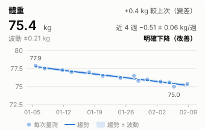 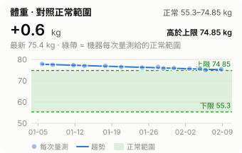

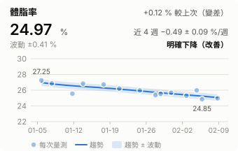 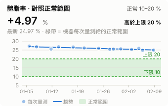

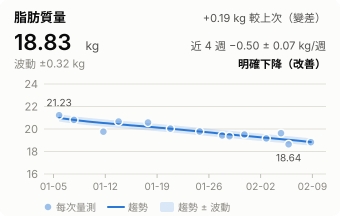 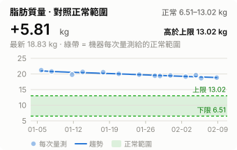

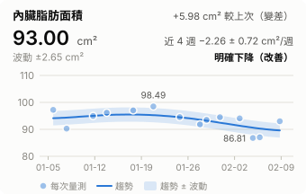 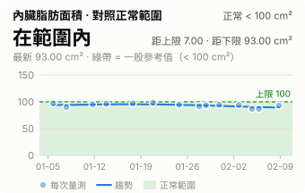

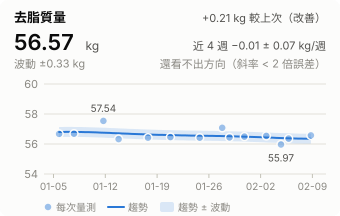 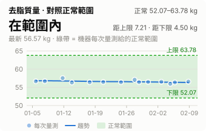

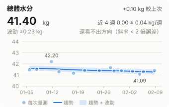 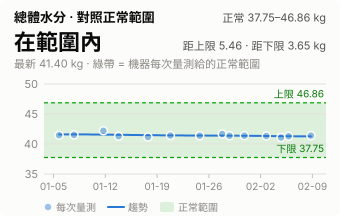

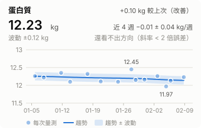 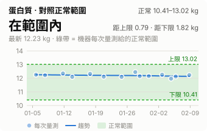

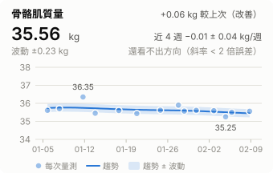 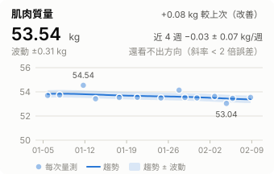

### 由其他指標算出來的：不另算趨勢

BMI = 體重 ÷ 身高²、基礎代謝率 = 370 + 21.6 × 去脂質量、骨骼肌質量指數 = 骨骼肌 ÷ 身高²（QR 欄位關係檢查每次都驗證這三條）。和來源指標是同一組數字，形狀一模一樣，所以只把點依序連起來、不另算趨勢 —— 趨勢請看體重、去脂質量、骨骼肌質量那幾張。

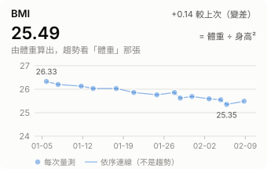 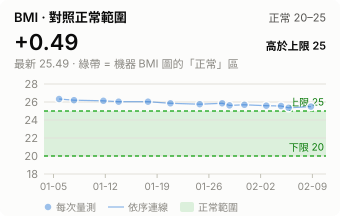

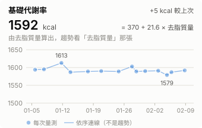 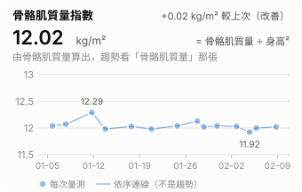

### 短期不該變的：看平均與波動

骨密度幾週到幾個月內不會真的改變；相位角只到小數一位、短期變化小；細胞外液比看水分分布有沒有異常。這幾個的起伏多半是量測誤差，畫趨勢線會誤導，所以只畫平均（虛線）± 1 標準差（淡藍帶）。要累積幾個月、平均明顯移動了才有意義。

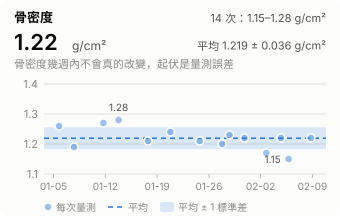 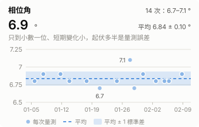

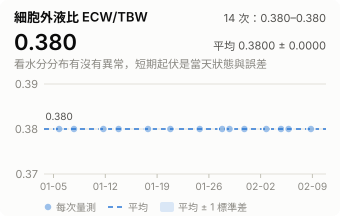

## 完整數值

| 量測時間 | 機器時間 | 體重 (kg) | 體脂率 (%) | 脂肪質量 (kg) | 內臟脂肪面積 (cm²) | 骨骼肌質量 (kg) | 肌肉質量 (kg) | 去脂質量 (kg) | 骨密度 (g/cm²) | 總體水分 (kg) | 細胞外液比 ECW/TBW | 相位角 (°) | 基礎代謝率 (kcal) | 蛋白質 (kg) | BMI | 骨骼肌質量指數 (kg/m²) | 必須脂肪 (kg) | 儲存脂肪 (kg) | 細胞內液 (kg) | 細胞外液 (kg) | 細胞外質量 (kg) | 身體細胞質量 (kg) | 骨礦物質 (kg) | 去脂質量 (%) | ASMI (kg/m²) | 上肢肌肉量 (kg) | 下肢肌肉量 (kg) | 體重 (標準%) | 骨密度 T-score |
|:--|--:|--:|--:|--:|--:|--:|--:|--:|--:|--:|--:|--:|--:|--:|--:|--:|--:|--:|--:|--:|--:|--:|--:|--:|--:|--:|--:|--:|--:|
| 2026-02-08 19:01 | 02-08 11:01:00 | 75.4 | 24.97 | 18.83 | 93.00 | 35.56 | 53.54 | 56.57 | 1.22 | 41.40 | 0.380 | 6.9 | 1592 | 12.23 | 25.49 | 12.02 | 2.26 | 16.57 | 25.67 | 15.73 | 19.23 | 37.34 | 2.94 | 75.03 | 9.76 | 7.56 | 21.30 | 115.85 | 0.65 |
| 2026-02-05 18:40 | 02-05 10:40:00 | 75.0 | 24.85 | 18.64 | 87.02 | 35.50 | 53.46 | 56.36 | 1.15 | 41.30 | 0.380 | 6.8 | 1587 | 12.13 | 25.35 | 12.00 | 2.25 | 16.39 | 25.61 | 15.69 | 19.16 | 37.20 | 2.93 | 75.15 | 9.71 | 7.49 | 21.25 | 115.23 | 0.15 |
| 2026-02-04 18:01 | 02-04 10:01:00 | 75.6 | 25.97 | 19.63 | 86.81 | 35.25 | 53.04 | 55.97 | 1.22 | 41.09 | 0.380 | 6.8 | 1579 | 11.97 | 25.55 | 11.92 | 2.27 | 17.36 | 25.48 | 15.61 | 19.03 | 36.94 | 2.91 | 74.03 | 9.68 | 7.49 | 21.16 | 116.16 | 0.24 |
| 2026-02-02 18:17 | 02-02 10:17:00 | 75.7 | 25.31 | 19.16 | 94.07 | 35.59 | 53.62 | 56.54 | 1.17 | 41.34 | 0.380 | 6.8 | 1591 | 12.26 | 25.59 | 12.03 | 2.27 | 16.89 | 25.63 | 15.71 | 19.22 | 37.32 | 2.94 | 74.69 | 9.78 | 7.59 | 21.33 | 116.31 | 0.26 |
| 2026-01-30 19:07 | 01-30 11:07:00 | 76.0 | 25.67 | 19.51 | 94.50 | 35.61 | 53.50 | 56.49 | 1.22 | 41.39 | 0.380 | 6.9 | 1590 | 12.16 | 25.69 | 12.04 | 2.28 | 17.23 | 25.66 | 15.73 | 19.21 | 37.28 | 2.94 | 74.33 | 9.78 | 7.51 | 21.43 | 116.77 | 0.37 |
| 2026-01-28 19:00 | 01-28 11:00:00 | 75.8 | 25.54 | 19.36 | 93.50 | 35.57 | 53.53 | 56.44 | 1.23 | 41.36 | 0.380 | 6.7 | 1589 | 12.15 | 25.62 | 12.02 | 2.27 | 17.09 | 25.64 | 15.72 | 19.19 | 37.25 | 2.93 | 74.46 | 9.81 | 7.58 | 21.43 | 116.46 | 0.03 |
| 2026-01-27 19:07 | 01-27 11:07:00 | 76.5 | 25.39 | 19.42 | 91.83 | 35.90 | 54.14 | 57.08 | 1.20 | 41.66 | 0.380 | 7.1 | 1603 | 12.45 | 25.86 | 12.13 | 2.29 | 17.13 | 25.83 | 15.83 | 19.41 | 37.67 | 2.97 | 74.61 | 9.88 | 7.59 | 21.64 | 117.54 | 0.25 |
| 2026-01-24 18:21 | 01-24 10:21:00 | 76.2 | 25.96 | 19.78 | 94.54 | 35.62 | 53.49 | 56.42 | 1.21 | 41.39 | 0.380 | 6.8 | 1589 | 12.10 | 25.76 | 12.04 | 2.29 | 17.49 | 25.66 | 15.73 | 19.18 | 37.24 | 2.93 | 74.04 | 9.80 | 7.57 | 21.41 | 117.08 | 0.19 |
| 2026-01-20 19:02 | 01-20 11:02:00 | 76.5 | 26.20 | 20.04 | 98.49 | 35.43 | 53.55 | 56.46 | 1.24 | 41.41 | 0.380 | 6.7 | 1590 | 12.11 | 25.86 | 11.98 | 2.29 | 17.75 | 25.67 | 15.74 | 19.20 | 37.26 | 2.94 | 73.80 | 9.72 | 7.51 | 21.26 | 117.54 | 0.26 |
| 2026-01-17 18:30 | 01-17 10:30:00 | 77.0 | 26.73 | 20.58 | 97.03 | 35.60 | 53.53 | 56.42 | 1.21 | 41.17 | 0.380 | 6.8 | 1589 | 12.32 | 26.03 | 12.03 | 2.31 | 18.27 | 25.53 | 15.64 | 19.18 | 37.24 | 2.93 | 73.27 | 9.78 | 7.53 | 21.41 | 118.31 | -0.29 |
| 2026-01-13 19:05 | 01-13 11:05:00 | 77.0 | 26.84 | 20.67 | 96.17 | 35.45 | 53.43 | 56.33 | 1.28 | 41.30 | 0.380 | 6.8 | 1587 | 12.10 | 26.03 | 11.98 | 2.31 | 18.36 | 25.61 | 15.69 | 19.15 | 37.18 | 2.93 | 73.16 | 9.75 | 7.48 | 21.35 | 118.31 | 0.61 |
| 2026-01-11 17:54 | 01-11 09:54:00 | 77.3 | 25.56 | 19.76 | 94.96 | 36.35 | 54.54 | 57.54 | 1.27 | 42.20 | 0.380 | 6.9 | 1613 | 12.35 | 26.13 | 12.29 | 2.32 | 17.44 | 26.16 | 16.04 | 19.56 | 37.98 | 2.99 | 74.44 | 9.98 | 7.75 | 21.78 | 118.77 | 0.43 |
| 2026-01-07 18:19 | 01-07 10:19:00 | 77.5 | 26.85 | 20.81 | 90.28 | 35.70 | 53.74 | 56.69 | 1.19 | 41.52 | 0.380 | 6.9 | 1595 | 12.22 | 26.20 | 12.07 | 2.32 | 18.49 | 25.74 | 15.78 | 19.27 | 37.42 | 2.95 | 73.15 | 9.72 | 7.57 | 21.19 | 119.08 | 0.43 |
| 2026-01-05 18:05 | 01-05 10:05:00 | 77.9 | 27.25 | 21.23 | 97.23 | 35.61 | 53.70 | 56.67 | 1.26 | 41.46 | 0.380 | 6.8 | 1594 | 12.26 | 26.33 | 12.04 | 2.34 | 18.89 | 25.71 | 15.75 | 19.27 | 37.40 | 2.95 | 72.75 | 9.81 | 7.58 | 21.43 | 119.69 | 0.31 |

---
由 `scripts/report.py` 產生，請勿手動編輯
