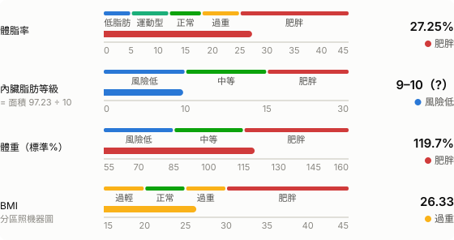
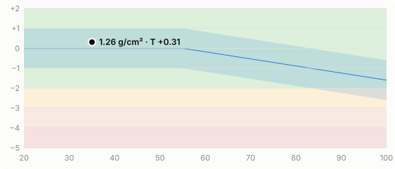
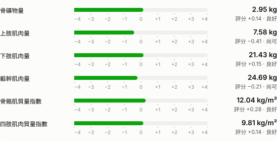
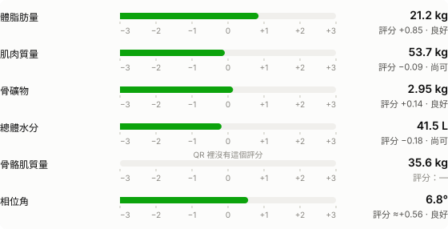
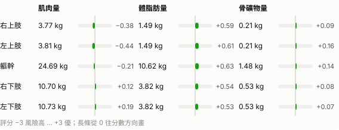

# 體組成報告 · 2026-01-05 18:05

> 實際量測時間 **2026-01-05 18:05**（台灣時間）· 機器時間 2026-01-05 10:05:00（UTC；換算後與實際時間吻合）  
> 資料來源：STARBIA 701 QR（該次沒有螢幕照片可直接比對；欄位位置已驗證）  

| 姓名 | ID | 性別 | 年齡 | 身高 | 檢測時間 |
|:--|:--|:--|:--|:--|--:|
| 示範 | DEMO | 男性 | 35 | 172.0 cm | 2026-01-05 18:05 |

## 體組成分析

| 項目 | 數值 | 正常範圍 | 判定 |
|:--|--:|--:|:--|
| 體重 | 77.9 kg | 55.3–74.85 | ▲ 高於範圍 |
| 脂肪質量 | 21.2 kg | 6.5–13.0 | ▲ 高於範圍 |
| 　必須脂肪 | 2.3 kg |  |  |
| 　儲存脂肪 | 18.9 kg |  |  |
| 體脂率 | 27.25 % | 10.0–20.0 | ▲ 高於範圍 |
| 去脂質量 | 56.7 kg | 52.1–63.8 | 在範圍內 |
| 　去脂質量（% 體重） | 72.75 % |  |  |
| 蛋白質質量 | 12.3 kg | 10.4–13.0 | 在範圍內 |
| 總體水分 | 41.5 kg | 37.75–46.9 | 在範圍內 |
| 　細胞內液 | 25.7 kg |  |  |
| 　細胞外液 | 15.75 kg |  |  |
| 骨礦物質 | 2.95 kg | 2.6–3.6 | 在範圍內 |
| 身體細胞質量 | 37.4 kg | 33.8–41.65 | 在範圍內 |
| 細胞外質量 | 19.3 kg | 15.6–19.5 | 在範圍內 |

正常範圍是機器每次量測給的（括號值），每次都不一樣。

## 體組成評估

## 骨健康與肌肉評估

x 軸年齡、y 軸 YA T-score。藍帶 = 同齡參考 ±1（依螢幕描繪，約略）；底色 ≥ −2 綠、−2~−3 黃、−3~−4 橘、< −4 紅。點的位置用實際年齡。

## 主要指標

評分已用三天的螢幕照片確認；相位角評分前標「≈」是推定值（±0.07）；骨骼肌評分 QR 裡沒有，所以不畫長條（見文末可信度說明）。

## 身體組成比例

## 各肢段

| 肢段 | 肌肉 kg | 評分 | 體脂肪 kg | 評分 | 骨礦物 kg | 評分 |
|:--|--:|--:|--:|--:|--:|--:|
| 右上肢 | 3.77 | −0.38 | 1.49 | +0.59 | 0.21 | +0.09 |
| 左上肢 | 3.81 | −0.44 | 1.49 | +0.61 | 0.21 | +0.16 |
| 軀幹 | 24.69 | −0.21 | 10.62 | +0.63 | 1.48 | +0.14 |
| 右下肢 | 10.70 | +0.12 | 3.82 | +0.54 | 0.53 | +0.08 |
| 左下肢 | 10.73 | +0.19 | 3.82 | +0.53 | 0.53 | +0.07 |

## 其他數值

| 項目 | 數值 | 備註 |
|:--|--:|:--|
| BMI | 26.33 | 螢幕上只有圖；= 體重 ÷ 身高² 吻合 |
| 內臟脂肪面積 | 97.23 cm² | 一般參考值 < 100 |
| 骨骼肌質量 | 35.6 kg |  |
| 肌肉質量 | 53.70 kg |  |
| 骨密度 | 1.26 g/cm² |  |
| 骨密度 YA T-score | 0.31 |  |
| 相位角 | 6.8 ° |  |
| 骨骼肌質量指數 SMI | 12.04 kg/m² |  |
| 四肢肌肉質量指數 ASMI | 9.81 kg/m² |  |
| 上肢肌肉量 | 7.58 kg |  |
| 下肢肌肉量 | 21.43 kg |  |
| 體重（標準%） | 119.7 % |  |
| 基礎代謝率 | 1594 kcal | 螢幕上沒有；= 370 + 21.6 × 去脂質量 吻合 |
| 細胞外液比 ECW/TBW | 0.380 | 自行計算（螢幕上沒有） |

## 檢測結果分析與建議

- **體脂率（BFP）**：您的 BFP 為 27.25%，高於建議值，代謝風險提高，宜調整飲食及增加運動

文字照機器報告的說法，依數值自動產生。

## 可信度說明

- **✅ 確認**：所有表格數值與範圍、各肢段 kg 與評分、9 個整體評分（脂肪、肌肉、骨礦物、水分、上肢、下肢、軀幹、SMI、ASMI）、骨密度 T-score — 本工具的作者用三天的螢幕照片逐項對照，三天都吻合（[驗證方法與結果](../../docs/VALIDATION.md)）。這份報告用的是同一組欄位位置；如果你的機器韌體不同，可以用自己的螢幕照片重新驗證。
- **🟡 推定**：相位角評分（標「≈」）：QR 用一位小數的相位角計算，螢幕用未進位的值，差最多 ±0.07；內臟脂肪等級（= 面積 ÷ 10；取整規則未知，小數 ≥ .5 時標「?」）；體脂率與 BMI 的分類分界（依螢幕刻度量得，女性的分界未經核對）；骨密度圖的同齡參考帶（依螢幕描繪）。
- **⚪ 未還原**：骨骼肌評分：螢幕上有長條，但 QR 裡沒有吻合的欄位（可能是機器顯示時才計算）；BMI 各年齡風險曲線；相位角百分位圖；生物阻抗向量圖。
- **ℹ️ 本 repo 自訂**：評分的狀態文字與顏色（良好／尚可／注意／警示／風險高，以 0／−1／−2／−2.5 分界）；「與上次比較」的改善／變差判斷。機器只用漸層色。

---
[← 歷史報表](../history.md) · 由 `scripts/report.py` 產生，請勿手動編輯
