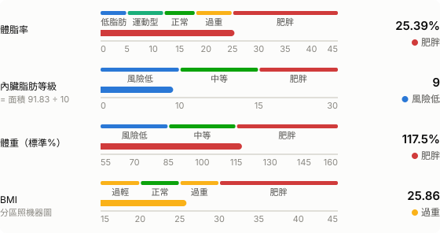
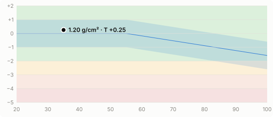
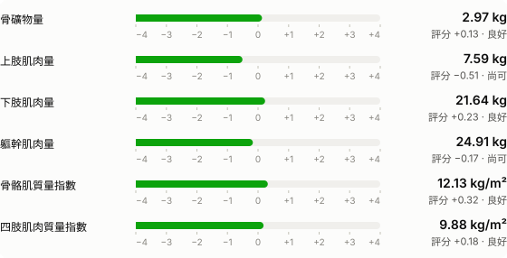
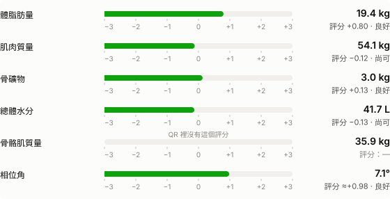
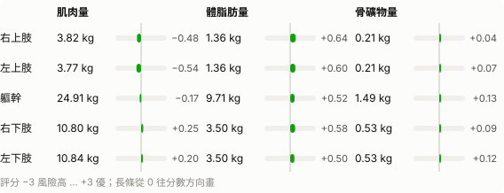

# 體組成報告 · 2026-01-27 19:07

> 實際量測時間 **2026-01-27 19:07**（台灣時間）· 機器時間 2026-01-27 11:07:00（UTC；換算後與實際時間吻合）  
> 資料來源：STARBIA 701 QR（該次沒有螢幕照片可直接比對；欄位位置已驗證）  

| 姓名 | ID | 性別 | 年齡 | 身高 | 檢測時間 |
|:--|:--|:--|:--|:--|--:|
| 示範 | DEMO | 男性 | 35 | 172.0 cm | 2026-01-27 19:07 |

## 體組成分析

| 項目 | 數值 | 正常範圍 | 判定 |
|:--|--:|--:|:--|
| 體重 | 76.5 kg | 55.3–74.85 | ▲ 高於範圍 |
| 脂肪質量 | 19.4 kg | 6.5–13.0 | ▲ 高於範圍 |
| 　必須脂肪 | 2.3 kg |  |  |
| 　儲存脂肪 | 17.1 kg |  |  |
| 體脂率 | 25.4 % | 10.0–20.0 | ▲ 高於範圍 |
| 去脂質量 | 57.1 kg | 52.1–63.8 | 在範圍內 |
| 　去脂質量（% 體重） | 74.6 % |  |  |
| 蛋白質質量 | 12.45 kg | 10.4–13.0 | 在範圍內 |
| 總體水分 | 41.7 kg | 37.75–46.9 | 在範圍內 |
| 　細胞內液 | 25.8 kg |  |  |
| 　細胞外液 | 15.8 kg |  |  |
| 骨礦物質 | 3.0 kg | 2.6–3.6 | 在範圍內 |
| 身體細胞質量 | 37.7 kg | 33.8–41.65 | 在範圍內 |
| 細胞外質量 | 19.4 kg | 15.6–19.5 | 在範圍內 |

正常範圍是機器每次量測給的（括號值），每次都不一樣。

## 體組成評估

## 骨健康與肌肉評估

x 軸年齡、y 軸 YA T-score。藍帶 = 同齡參考 ±1（依螢幕描繪，約略）；底色 ≥ −2 綠、−2~−3 黃、−3~−4 橘、< −4 紅。點的位置用實際年齡。

## 主要指標

評分已用三天的螢幕照片確認；相位角評分前標「≈」是推定值（±0.07）；骨骼肌評分 QR 裡沒有，所以不畫長條（見文末可信度說明）。

## 身體組成比例

## 各肢段

| 肢段 | 肌肉 kg | 評分 | 體脂肪 kg | 評分 | 骨礦物 kg | 評分 |
|:--|--:|--:|--:|--:|--:|--:|
| 右上肢 | 3.82 | −0.48 | 1.36 | +0.64 | 0.21 | +0.04 |
| 左上肢 | 3.77 | −0.54 | 1.36 | +0.60 | 0.21 | +0.07 |
| 軀幹 | 24.91 | −0.17 | 9.71 | +0.52 | 1.49 | +0.13 |
| 右下肢 | 10.80 | +0.25 | 3.50 | +0.58 | 0.53 | +0.09 |
| 左下肢 | 10.84 | +0.20 | 3.50 | +0.50 | 0.53 | +0.12 |

## 其他數值

| 項目 | 數值 | 備註 |
|:--|--:|:--|
| BMI | 25.86 | 螢幕上只有圖；= 體重 ÷ 身高² 吻合 |
| 內臟脂肪面積 | 91.83 cm² | 一般參考值 < 100 |
| 骨骼肌質量 | 35.9 kg |  |
| 肌肉質量 | 54.14 kg |  |
| 骨密度 | 1.20 g/cm² |  |
| 骨密度 YA T-score | 0.25 |  |
| 相位角 | 7.1 ° |  |
| 骨骼肌質量指數 SMI | 12.13 kg/m² |  |
| 四肢肌肉質量指數 ASMI | 9.88 kg/m² |  |
| 上肢肌肉量 | 7.59 kg |  |
| 下肢肌肉量 | 21.64 kg |  |
| 體重（標準%） | 117.5 % |  |
| 基礎代謝率 | 1603 kcal | 螢幕上沒有；= 370 + 21.6 × 去脂質量 吻合 |
| 細胞外液比 ECW/TBW | 0.380 | 自行計算（螢幕上沒有） |

## 檢測結果分析與建議

- **體脂率（BFP）**：您的 BFP 為 25.39%，高於建議值，代謝風險提高，宜調整飲食及增加運動

文字照機器報告的說法，依數值自動產生。

## 與上次比較（2026-01-24 18:21）

| 項目 | 上次 | 這次 | 變化 |  |
|:--|--:|--:|--:|:--|
| 體重 | 76.2 kg | 76.5 kg | +0.3 kg | 變差 |
| 體脂率 | 25.96 % | 25.39 % | −0.57 % | 改善 |
| 脂肪質量 | 19.78 kg | 19.42 kg | −0.36 kg | 改善 |
| 內臟脂肪面積 | 94.54 cm² | 91.83 cm² | −2.71 cm² | 改善 |
| 骨骼肌質量 | 35.62 kg | 35.90 kg | +0.28 kg | 改善 |
| 肌肉質量 | 53.49 kg | 54.14 kg | +0.65 kg | 改善 |
| 去脂質量 | 56.42 kg | 57.08 kg | +0.66 kg | 改善 |
| 骨密度 | 1.21 g/cm² | 1.20 g/cm² | −0.01 g/cm² |  |
| 總體水分 | 41.39 kg | 41.66 kg | +0.27 kg |  |
| 相位角 | 6.8 ° | 7.1 ° | +0.3 ° |  |

改善／變差是本 repo 依指標方向自訂的判斷（體重、脂肪、內臟脂肪越低越好；肌肉越高越好）。骨密度、相位角短期不會真的改變，單次差異多半是量測誤差，不判斷。單次變化在「波動」之內都不用在意，趨勢請看[歷史報表](../history.md)。

## 可信度說明

- **✅ 確認**：所有表格數值與範圍、各肢段 kg 與評分、9 個整體評分（脂肪、肌肉、骨礦物、水分、上肢、下肢、軀幹、SMI、ASMI）、骨密度 T-score — 本工具的作者用三天的螢幕照片逐項對照，三天都吻合（[驗證方法與結果](../../docs/VALIDATION.md)）。這份報告用的是同一組欄位位置；如果你的機器韌體不同，可以用自己的螢幕照片重新驗證。
- **🟡 推定**：相位角評分（標「≈」）：QR 用一位小數的相位角計算，螢幕用未進位的值，差最多 ±0.07；內臟脂肪等級（= 面積 ÷ 10；取整規則未知，小數 ≥ .5 時標「?」）；體脂率與 BMI 的分類分界（依螢幕刻度量得，女性的分界未經核對）；骨密度圖的同齡參考帶（依螢幕描繪）。
- **⚪ 未還原**：骨骼肌評分：螢幕上有長條，但 QR 裡沒有吻合的欄位（可能是機器顯示時才計算）；BMI 各年齡風險曲線；相位角百分位圖；生物阻抗向量圖。
- **ℹ️ 本 repo 自訂**：評分的狀態文字與顏色（良好／尚可／注意／警示／風險高，以 0／−1／−2／−2.5 分界）；「與上次比較」的改善／變差判斷。機器只用漸層色。

---
[← 歷史報表](../history.md) · 由 `scripts/report.py` 產生，請勿手動編輯
